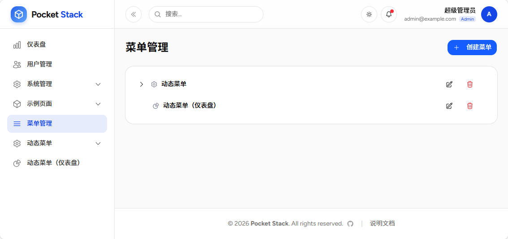
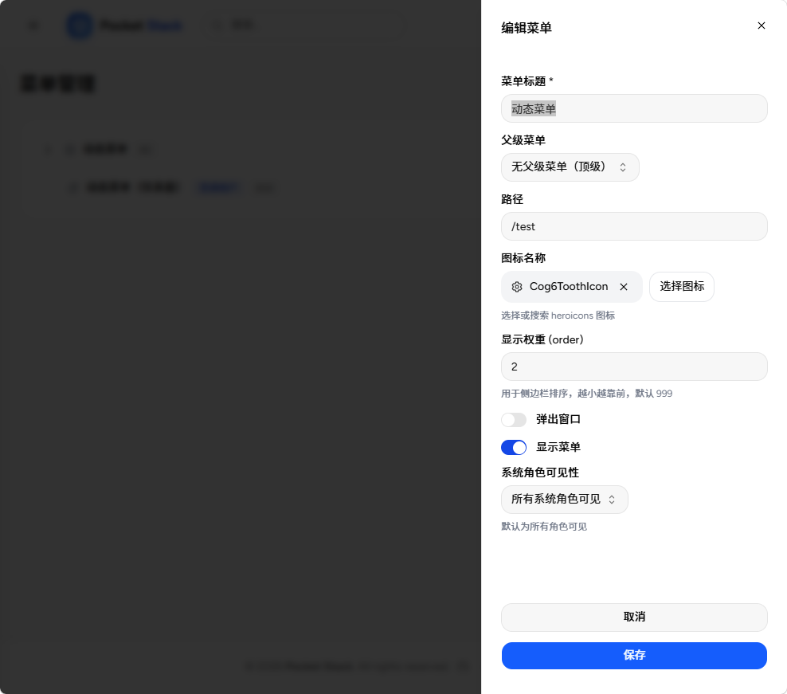

# 菜单管理模块

PocketStack 的菜单定义机制主要依靠模块中的 `menu.ts` 文件定义。该方案适合 vibe coding 开发场景，但程序构建完成后菜单配置无法动态修改。

本模块弥补了这一缺陷，提供基于数据库的菜单动态管理和配置功能，并与系统「设置 → 菜单设置」配合，实现自定义菜单的合并与实时同步。

## 功能特性

- **树形结构展示**：支持二级嵌套结构，支持展开/折叠
- **排序控制**：通过 `order` 字段控制菜单显示顺序（越小越靠前，默认 999）
- **角色可见性**：通过统一的可见性选择器控制菜单对不同角色的可见性
- **图标选择**：集成 Heroicons 图标选择器
- **外部链接**：支持跳转到外部 URL（新窗口打开）
- **显示/隐藏**：可控制菜单项是否在侧边栏显示（保留数据但不渲染）
- **徽章展示**：列表中以彩色徽章显示菜单属性（隐藏 / 管理员 / 普通用户 / 外链 / #order）
- **缓存机制**：修改菜单后自动清除缓存，确保侧边栏实时刷新

## 数据集

### `system_menu`

存储菜单项数据，主要字段：

| 字段         | 类型     | 必填 | 说明                                                       |
| ------------ | -------- | ---- | ---------------------------------------------------------- |
| `title`      | text     | 是   | 菜单标题                                                   |
| `parent`     | relation | 否   | 父菜单 ID（自关联，实现层级结构）                          |
| `path`       | text     | 否   | 路由路径                                                   |
| `icon`       | text     | 否   | heroicons 图标名称（来自 24/outline）                      |
| `order`      | number   | 否   | 排序权重，越小越靠前，默认 999                             |
| `external`   | bool     | 否   | 是否为外部链接（在新窗口打开）                             |
| `show`       | bool     | 否   | 是否在侧边栏显示                                           |
| `userOnly`   | bool     | 否   | 仅普通用户可见（由可见性选择器自动设置）                   |
| `adminOnly`  | bool     | 否   | 仅管理员可见（由可见性选择器自动设置）                     |
| `created`    | autodate | -   | 创建时间（自动）                                           |
| `updated`    | autodate | -   | 更新时间（自动）                                           |

## 菜单显示规则

### 生效条件

1. 需要在「设置 → 菜单设置」中开启「启用自定义菜单」开关
2. 数据集菜单不会自动渲染，必须通过设置开关激活

### 合并策略

- **自定义菜单不覆盖默认模块菜单**，而是追加在模块菜单之后
- 自定义菜单按 `order` 字段排序
- 根据当前用户角色应用 `adminOnly` / `userOnly` 过滤

### 与模块管理的协作

- 可通过「模块管理」中的「显示菜单」开关隐藏指定模块的菜单
- 关闭模块菜单后，该模块的菜单不会显示，但自定义菜单不受影响
- 如需完全使用自定义菜单，应在「模块管理」中关闭所有模块的「显示菜单」开关

## 使用说明

### 模块安装

1. 将 `menu` 目录复制到 `src/modules` 目录下
2. 将 `src/modules/menu/migrations/menu_items.json` 文件导入到 pocketbase 中。

完成以上步骤后，即可使用模块管理动态菜单，系统也会自动发现并将数据库中存在的菜单项加载到左侧菜单。

## 模块使用

### 菜单配置

模块安装后，即可在左侧菜单中显示`菜单管理`链接，点击后即可进入菜单管理页面。

### 创建/编辑菜单

点击右上角的`创建菜单`按钮，或点击菜单列表右侧的编辑图标，即可弹出表单，进行创建/编辑操作。

### 菜单的显示规则

1. 只有打开了`系统设置->显示菜单`开关的表单项才能在侧边栏显示。
2. 动态菜单会在模块菜单下面展示。