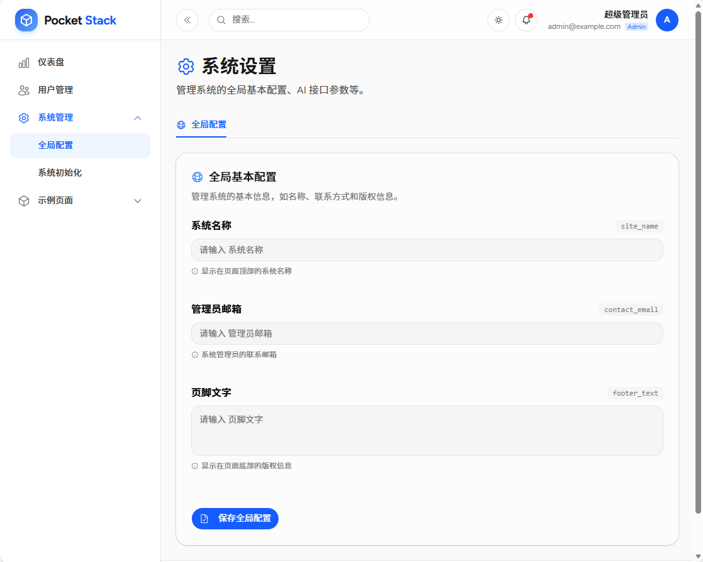

# 系统设置模块 (Settings)

系统设置模块提供系统全局配置与各模块自定义配置的集中管理界面。采用「模块 `settings.tsx` 自动注册 Tab + 声明式字段自动渲染」的插件式架构。

## 模块信息

| 属性 | 值 |
|------|-----|
| **包名** | `@pocketstack/settings` |
| **版本** | `1.0.0` |
| **类型** | `module` |
| **权限** | `adminOnly` (仅超级管理员) |

## 页面结构

| 页面 | 路径 | 说明 |
|------|------|------|
| 系统设置 | `/settings` | 系统与各模块配置管理 |

## 界面截图



## 功能特性

### 系统全局配置 Tab

系统内置「全局配置」Tab（key 前缀 `system_`），提供以下配置项：

| 存储 Key | 名称 | 说明 |
|----------|------|------|
| `system_site_name` | 系统名称 | 显示在页面顶部的系统名称 |
| `system_contact_email` | 管理员邮箱 | 系统管理员的联系邮箱 |
| `system_footer_text` | 页脚文字 | 显示在页面底部的版权信息 |

内置 Tab 定义位于 `src/modules/settings/systemSettings.ts`。

### 模块设置自动注册

任何模块在根目录提供 `settings.tsx`（默认导出 `ModuleSettings`）即可自动注册为系统设置页的一个 Tab，无需改动系统设置模块。

| 模块 | settings 文件 | Tab 标题 | key 前缀 |
|------|--------------|----------|----------|
| 菜单 (menu) | `src/modules/menu/settings.tsx` | 菜单设置 | `menu_` |
| 示例 (examples) | `src/modules/examples/settings.tsx` | 示例模块 | `examples_` |

### 字段 key 自动加模块名前缀

每个模块的设置字段在存储时会自动加上 `{模块名}_` 前缀，避免不同模块之间 key 冲突。例如菜单模块声明的短 key `enable_custom_menu`，最终存储为 `menu_enable_custom_menu`。

> **兼容性说明**：旧版无前缀的 `site_name`、`contact_email`、`footer_text`、`enable_custom_menu` 等 key 已迁移为带前缀形式（`system_*` / `menu_*`），页面布局、侧边栏等引用处已同步更新。

### 声明式字段 + 自动渲染

设置字段通过声明式结构描述，系统设置页按 `type` 自动渲染控件，支持类型：

| type | 控件 |
|------|------|
| `text` | 单行输入框 |
| `textarea` | 多行输入框 |
| `number` | 数字输入框（支持 min/max/step） |
| `switch` | 布尔开关 |
| `select` | 下拉选择（options） |

### 配置保存机制

- 每个 Tab 独立保存自己的配置项（`saveTab`）
- 配置通过 PocketBase `system_settings` collection 存储（`key`、`value`、`description`）
- 保存后自动刷新全局设置状态

## 为模块新增设置（扩展指南）

1. 在模块根目录新建 `settings.tsx`，默认导出 `ModuleSettings`：

```typescript
import { Cog6ToothIcon } from '@heroicons/react/24/outline';
import type { ModuleSettings } from '@/lib/module-settings';

const settings: ModuleSettings = {
    title: '我的模块',        // Tab 标题
    icon: Cog6ToothIcon,       // Tab 图标
    order: 20,                 // 可选，排序权重（越小越靠前，默认 100）
    description: '模块说明',   // 可选，Tab 内说明
    fields: [
        { type: 'switch', key: 'enable_xxx', label: '启用 xxx', description: '...', defaultValue: false },
        { type: 'text', key: 'api_url', label: '接口地址', placeholder: 'https://...' },
    ],
};

export default settings;
```

2. 保存后字段以 `{模块名}_{fieldKey}` 写入 `system_settings`，模块内通过 `useSettings().get('{模块名}_fieldKey')` 读取。

完整示例见 `src/modules/examples/settings.tsx`（覆盖所有字段类型）。

## 相关框架文件

- `src/lib/module-settings.ts` — 模块设置类型、收集（`collectModuleSettings`）与 key 拼接工具
- `src/modules/settings/components/ModuleSettingsForm.tsx` — 声明式字段自动渲染表单
- `src/modules/settings/systemSettings.ts` — 系统级「全局配置」Tab 定义

## PocketBase Collection

模块使用 `system_settings` collection 存储配置数据：

| 字段 | 类型 | 说明 |
|------|------|------|
| `key` | text | 配置键名（`{模块名}_字段key`），唯一索引 |
| `value` | json | 配置值 |
| `description` | text | 配置描述 |
